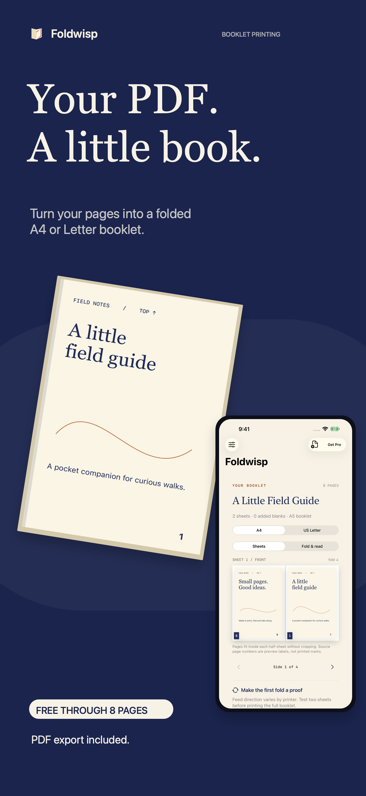
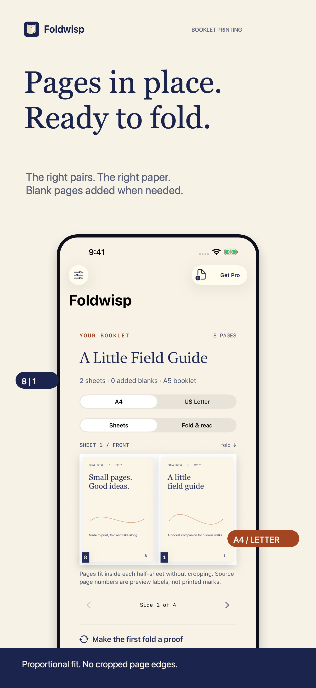
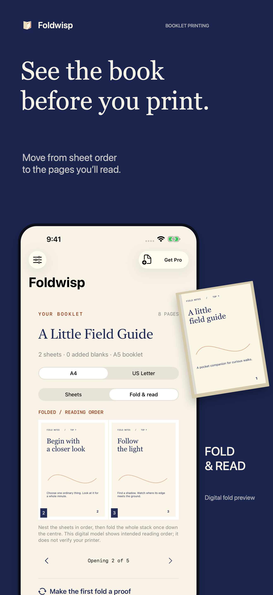
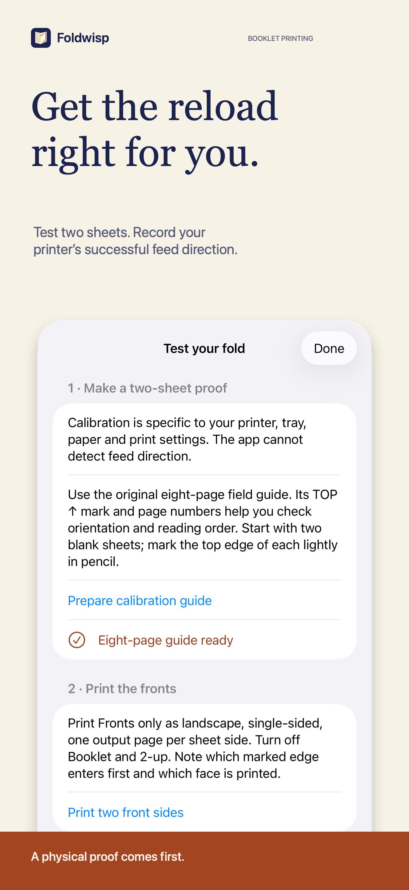
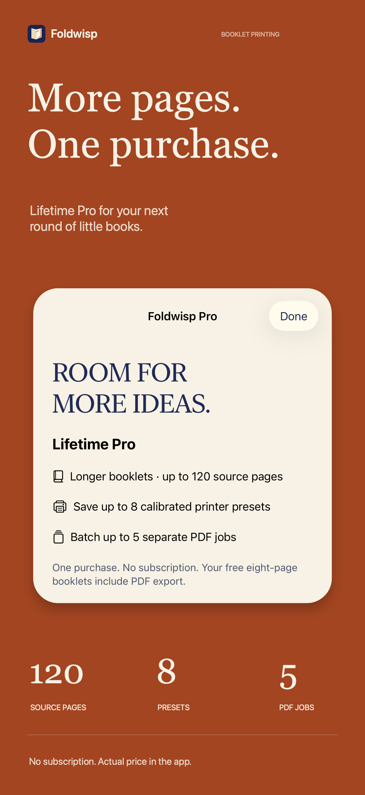
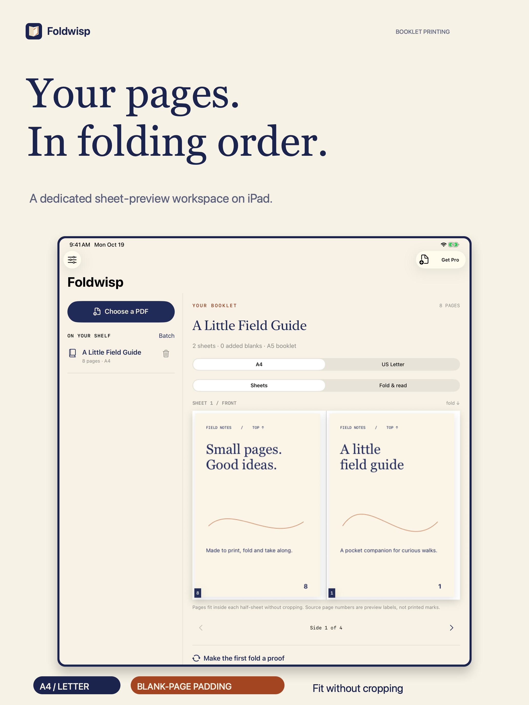

**Unsubmitted recovery work — October 21, 2026:** Unreadable and over-limit printer preset files now remain intact after Save or Remove actions, including at startup. Native preset and PDF/library suites passed 23 tests on both iOS 17 and 26.5, with one hardware-only file-protection check skipped on Simulator. Physical print output was not newly verified. The unsigned Release build passed. This is private-source work, not a new signed binary, submission, approval or resolution of Guideline 4.3. Premium campaign pixels are unchanged.

# Foldwisp: Booklet Printing

**A PDF on your device. A little book in your hands.**

Foldwisp arranges PDF pages onto A4 or US Letter sheets for a nested, folded booklet. A sheet preview explains the page pairs; a reading preview shows the intended result. An original two-sheet calibration guide helps users record their printer's reload direction before printing a full stack.

**Current status — October 20, 2026:** App 1.0 (1) rejected under Guideline 4.3(a) on October 20, 2026; Lifetime Pro Ready for Review. Recovery in progress; no new binary resubmission, approval or release. The submitted V1 source remains frozen. First clarification is drafted only, not sent. Prior physical/native results and explicit Sandbox/print-proof skips are historical, not new recovery tests. First app-specific clarification sent October20,2026; concrete Apple feedback pending. This is not a binary resubmission.

[Support](https://sepidehdalir.github.io/foldwisp-showcase/) · [Portfolio](https://github.com/sepidehdalir/ios-app-portfolio) · [Developer](https://www.arvinify.com)

## From source pages to folded pages

  

The free workflow exports complete booklets through eight source pages. Automatic blank-page padding rounds the source count to a multiple of four. Content fits proportionally inside each half-sheet without cropping.

## A workflow made for paper

 

Users can export both sides together or separate front and back passes. Reverse-back-stack and 180-degree back-rotation controls support the reload directions the user physically tests. A preset is a saved observation, not automatic printer detection. Native sharing, Save to Files and system printing complete the workflow.

Lifetime Pro is one non-consumable App Store purchase: up to 120 source pages, eight reusable printer presets and batches of five separate PDF jobs. There is no subscription. The app displays Apple's localized price and includes Restore Purchases.

## A dedicated iPad composition

The iPad layout places saved jobs beside a larger workspace. Accessibility text sizes switch to one column so the shelf does not crowd the document. Phone and tablet campaigns use separate layouts and authentic native captures, with original sample content.

[iPad campaign: value](assets/iPad/01-foldwisp.png) · [reading order](assets/iPad/03-foldwisp.png) · [calibration](assets/iPad/04-foldwisp.png) · [Lifetime Pro](assets/iPad/05-foldwisp.png)

## Engineering decisions

- **Native universal application:** SwiftUI, PDFKit, CoreGraphics and StoreKit 2; iOS/iPadOS 15 deployment with the installed iOS 26.5 SDK. No third-party runtime dependency.
- **Vector output:** source PDF pages are placed into bounded landscape sheet regions. The app does not rasterize a whole document to construct its print PDF.
- **Bounded input:** page, file-size and image-resource checks precede rendering; encrypted PDFs and printable forms/annotations require a supported flattened copy. Output is print-only and does not preserve attachments, interactivity or digital signatures.
- **Recoverable local work:** staged imports publish atomically. Batch failures roll back newly created jobs. Invalid saved records are retained and reported rather than silently deleted. Cancellation propagates without mislabeling healthy jobs as corrupt.
- **Verified purchase state:** StoreKit transactions and current entitlements control Pro. Refund/revocation removes access to new Pro actions without deleting saved content.
- **On-device documents:** protected local source copies, backup-excluded jobs and presets, temporary exports, explicit user-selected sharing. No account, analytics SDK, external AI or developer-operated document upload.

## Verification, with clear limits

Local core checks cover all supported page counts through an independent reading-order oracle; A4/Letter geometry and text placement; odd-page padding; mixed page boxes and rotation; maximum-page vector output; resource bounds; staged persistence; cancellation; and corrupt-record retention. The portable and iPad core runs each passed 18 checks, with the separate hardware file-protection check skipped in those environments. A physical iPhone 17 Pro Max on iOS 26.1 subsequently passed all 19 core checks, including hardware file protection; a subsequent physical UI run passed reading preview, native export/share, saved-job relaunch, background/resume and live Apple price loading. Genuine Sandbox transactions and restore remain unverified; the publisher subsequently instructed that testing be skipped.

Five local StoreKit lifecycle tests passed on iOS 17, including purchase, entitlement recreation, refund, pending approval, cancellation/error and restore behavior. Native sample/export/relaunch and dedicated phone/tablet capture flows have passed in simulators. The native iPad print-options screen was presented without sending a print job. Selected native contrast and control-description audits passed in Light and Dark Mode after correcting text, modal buttons and Form headings. The refreshed marketing campaign uses that final UI. Separately, the publisher completed the requested physical VoiceOver sample, reading preview, export, Pro and Settings flow and reported all controls worked. This is a bounded manual result, not exhaustive accessibility coverage.

These results do not establish physical folded output, genuine Apple Sandbox purchases, iOS 15 runtime behavior, device performance or App Store approval/release. An App Review submission receipt was separately verified on October 19. iOS 15 runtime is unavailable on the current host. TestFlight is intentionally skipped by publisher instruction; required production checks remain separate.

## Support and source policy

For help, email [hello@arvinify.com](mailto:hello@arvinify.com) with your device/iOS version, paper size, printer model and the steps you tried. Avoid sending private PDFs or payment details. Keep original documents and important exports outside the app; deleting the app removes its local library.

This public repository contains product documentation, original visual assets and reviewed marketing exports. The commercial implementation and private QA records are maintained in a separate private repository. No customer documents, signing material or credentials are included.

© 2026 Sepideh Javanbakht Dalir. All rights reserved.
